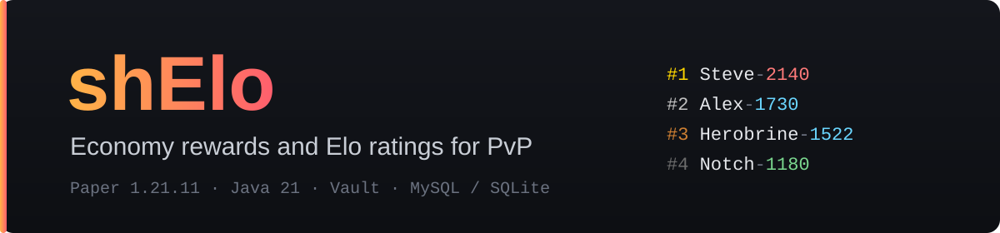

<p align="center">
  
</p>

<p align="center">
  <a href="https://github.com/Sh0ckuletz/shElo/actions/workflows/build.yml"></a>
  <a href="https://github.com/Sh0ckuletz/shElo/releases/latest"></a>
  <a href="LICENSE"></a>
</p>

shElo adds money rewards and an Elo rating to PvP on Paper servers. Killers earn money and
Elo, victims lose some, and a leaderboard, stats and chat colors follow from the rating.

## Features

- Configurable kill rewards and death penalties (money and Elo).
- Anti-farm protection for repeated kills: block the reward or reduce it.
- Leaderboard with `/elo top`, personal stats with `/stats` (peak Elo, K/D, streaks).
- Elo colors: automatic rules in `colors.yml`, or a menu where players pick a color they have unlocked.
- MySQL or SQLite storage, async queries, HikariCP pool.
- Vault rollback if the Elo update fails after a money transaction.
- PlaceholderAPI support, including offline players.
- Every message uses MiniMessage and lives in `messages.yml`.
- Config files update themselves when new options are added; your values are kept.

## In game

```
shElo » +30 Elo · +$300 · killed Notch (1180)

Elo Leaderboard · page 1/3 · 27 players
▬▬▬▬▬▬▬▬▬▬▬▬▬▬▬▬▬▬▬▬
#1 Steve - 2140 Elo
#2 Alex - 1730 Elo
#3 Herobrine - 1522 Elo
```

Colors, layout and wording are all editable in `messages.yml` and `menus.yml`.

## Installation

1. Download the jar from the [latest release](https://github.com/Sh0ckuletz/shElo/releases/latest).
2. Put it in `plugins/` together with Vault and an economy plugin (for example EssentialsX).
3. Start the server once, then pick a storage type in `plugins/shElo/config.yml`
   (`database.storage-type`, default `MYSQL`). For MySQL, fill in the rest of the `database` section.
4. Restart, or run `/elo reload`.

Requirements: Paper 1.21.11, Java 21, Vault. MySQL 8.0+ is only needed for `MYSQL`;
`SQLITE` stores everything in one local file. PlaceholderAPI 2.12.2+ is optional.

## Commands

| Command | Description | Permission |
| --- | --- | --- |
| `/elo` | Show your Elo | `shelo.command` |
| `/elo <player>` | Show another player's Elo | `shelo.command` |
| `/elo top [page]` | Leaderboard | `shelo.top` |
| `/elo reload` | Reload config, messages and the database connection | `shelo.reload` |
| `/elo set <player> <value>` | Set a player's Elo | `shelo.admin.set` |
| `/elo add <player> <value>` | Add Elo | `shelo.admin.add` |
| `/elo remove <player> <value>` | Remove Elo | `shelo.admin.remove` |
| `/elo reset <player>` | Reset to the starting value | `shelo.admin.reset` |
| `/stats [player]` | PvP statistics | `shelo.stats`, `shelo.stats.others` |
| `/elocolors` | Open the color menu (`MENU` mode only) | `shelo.colors` |

`shelo.admin` grants all four admin permissions. Everything except the admin and reload
permissions is granted to players by default.

## Placeholders

| Placeholder | Value |
| --- | --- |
| `%shelo_elo%` | Raw Elo |
| `%shelo_elo_formatted%` | Elo with its color applied |

## Configuration

| File | Purpose |
| --- | --- |
| `config.yml` | Rewards, penalties, anti-farm, worlds, database |
| `messages.yml` | All chat messages |
| `colors.yml` | Elo color rules (`AUTOMATIC` mode) |
| `menus.yml` | Color menu layout and tiers (`MENU` mode) |

## Building

```powershell
.\gradlew.bat build
```

The jar is written to `build/libs/`. You need JDK 21 (Gradle 8.14 does not run on JDK 25).

## bStats

The plugin reports anonymous usage metrics (server count, Paper version, storage type)
through [bStats](https://bstats.org/). You can turn this off for all plugins in
`plugins/bStats/config.yml` by setting `enabled: false`.

## License

Distributed under [GPL-3.0](LICENSE).
